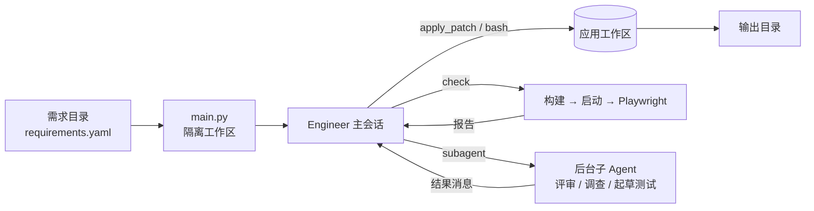

# ArcBench Agent

为 ArcBench Agentic Software Factory Hackathon 编写的编码 Agent。输入一份结构化需求，输出一个可以构建、启动并通过端到端浏览器测试的 Web 应用（React + Express + SQLite）。

比赛成绩：GitHub 协作平台 23/30，电子表格 26/30，合计 49/60，综合分 94.53，费用 4.54 CNY，第四名，一等奖。

## 定位

本项目不是面向普通用户的通用编程助手。它面向产业中的标准化需求，目标是从需求到产品的全链路稳定交付：产出的应用要能构建、能运行，并通过验收测试。

设计上需要在执行速度、开发准确性、token 消耗和幻觉控制之间取舍。因此我们不采用复杂的多 Agent 编排和分工，而是由一个主会话在同一个上下文里从读需求做到交付；子 Agent 只用于并行加速，以及分担机械性工作来节省 token。这样取舍的依据和实测数据见 [docs/architecture.md](docs/architecture.md) 第 3 节。

代码约 3,300 行 Python，没有框架依赖，只用到 `openai` 和 `pyyaml`。

## 工作方式



- **一个主会话负责到底**。Engineer 先写架构级计划，再按功能区分小片实现，每片都用 `check` 验证。
- **真实验证**。`check` 用交付时的命令构建前端，用 `npm start` 启动后端，在空数据库上运行 Agent 自己写的 Playwright 测试。如果上一阶段留下了数据库，还会在它的副本上再运行一遍。
- **后台子 Agent**。评审、故障调查、起草下一区域的测试交给子 Agent 并行处理，结果以消息形式送回，主会话不用等待。
- **按需加载规范**。读需求时，按触发词自动附带对应组件的规范（表单、菜单、网格等）。
- **可恢复**。主会话每一步都写入 transcript 和 git 提交，中断后可以从最后一步继续。

详细设计、探索过的方案和实测数据见 [docs/architecture.md](docs/architecture.md)。

## 运行

依赖：Python 3.12+、Node.js 20.19+、npm，以及 Playwright 的 Chromium。

```bash
pip install -r requirements.txt
cp .env.example .env   # 填写模型地址和 key，然后 export 这些变量

python3 main.py /path/to/requirements --output-dir /path/to/app
```

调用方式与 ArcBench 平台的入口约定一致（`python3 main.py REQUIREMENTS_DIR --output-dir OUTPUT_DIR --type web`）。中断后加 `--resume`，会从输出目录里记录的最后一步继续。

需求目录里需要有 `requirements.yaml`：一棵由 `FOLDER` 和 `ATOMIC` 节点组成的树，原子需求带 `description` 和 `scenarios`（GIVEN/WHEN/THEN 步骤）。

### 环境变量

| 变量 | 默认值 | 作用 |
| --- | --- | --- |
| `OPENAI_BASE_URL`、`OPENAI_API_KEY` | — | OpenAI 兼容的模型接口 |
| `MODEL` | `deepseek-v4-flash-vision-exp` | 所有会话使用的模型 |
| `MODEL_VISION` | 按模型名判断 | `1` 或 `0`，指定主模型能否直接读图 |
| `VISUAL_MODEL`、`VISUAL_BASE_URL`、`VISUAL_API_KEY` | 同上 | 主模型不能读图时，用于描述参考截图 |
| `AGENT_TIME_LIMIT_MINUTES` | `0`（不限） | 总时长上限。到期前 15 分钟要求收尾，到期后交付当前状态 |
| `AGENT_HELPERS` | `4` | 同时运行的子 Agent 数 |
| `AGENT_SANDBOX` | `1` | 设为 `0` 时关闭命令的文件系统沙箱 |
| `AGENT_REASONING_EFFORT` | `high` | 默认推理强度 |

### 测试

```bash
python3 -m unittest discover -s tests
ruff check . && ruff format --check .
mypy
```

单元测试使用假模型，不调用任何接口。Linux 沙箱测试只在 Linux 上运行。代码风格由 ruff 检查（行宽 120），类型由 mypy 检查，配置都在 `pyproject.toml`。

## 目录

| 路径 | 内容 |
| --- | --- |
| `main.py` | 平台入口：ArcBench 在包根目录运行 `python3 main.py`，它转到 `src/main.py` |
| `src/main.py` | 入口：隔离工作区、阶段识别、启动构建 |
| `src/roles.py` | 主会话和子 Agent 的提示词、工具与调度 |
| `src/loop.py` | 单个会话的工具调用循环 |
| `src/checks.py` | 构建、启动、运行 Playwright、生成报告 |
| `src/spec.py` | 需求树、需求卡片、大纲、变更指纹 |
| `src/tools.py`、`src/patch.py` | bash、`apply_patch`、`view_image` |
| `src/compaction.py` | 上下文裁剪与压缩 |
| `src/checkpoint.py` | transcript、git 检查点、断点续跑 |
| `src/llm.py` | 流式请求、请求对冲、断流重发、用量记录 |
| `src/sandbox.py` | Linux Landlock / macOS sandbox-exec 文件系统边界 |
| `src/rules.md`、`src/sop.md` | 工程规则与工作流程 |
| `src/skills/` | 按触发词加载的组件规范 |
| `src/template/` | 应用模板，来自 ArcBench 官方 starter |
| `tests/` | 单元测试，按模块分文件 |

## 致谢

- 本项目使用 [JuCode Desktop](https://github.com/JuCode-Team/JuCode-Desktop) 开发。
- 部分设计参考了 [JuCode CLI](https://github.com/JuCode-Team/JuCode-CLI)。

## 许可

[Apache License 2.0](LICENSE)。`src/template/` 目录来自 ArcBench 官方 starter，版权归原作者所有。
