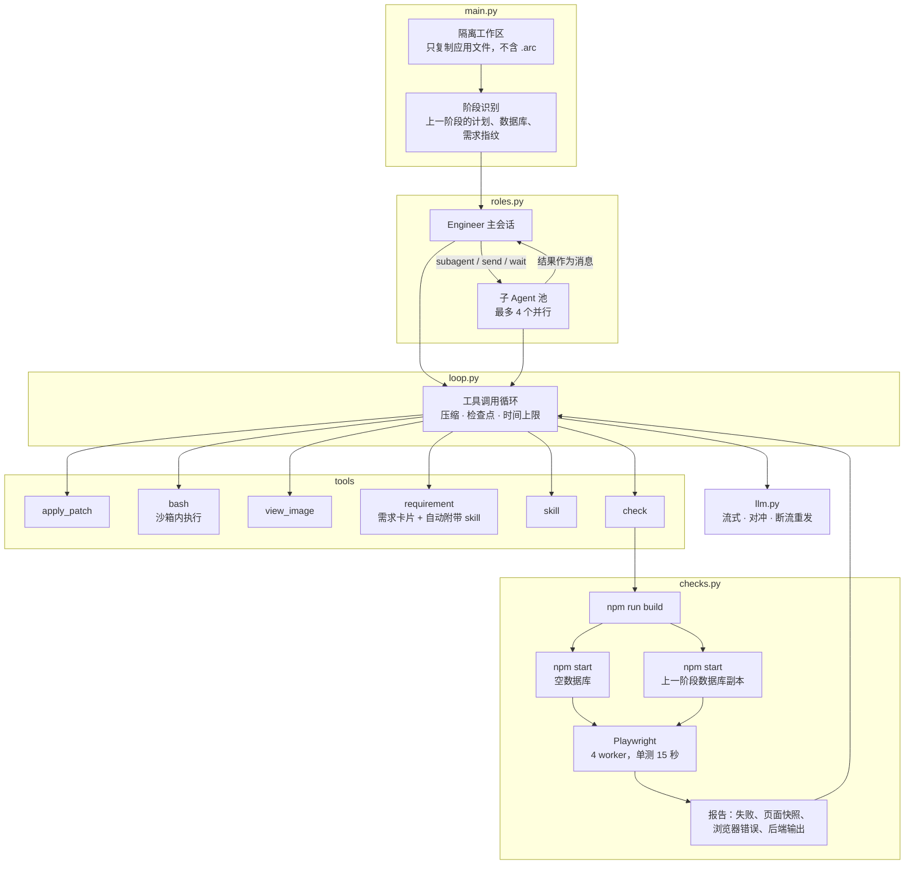
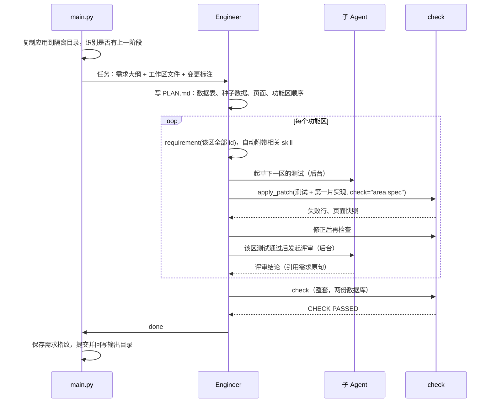

# 架构与设计

本文说明 Agent 的结构，以及每个设计为什么是现在这个样子。文中提到的源文件都在 `src/` 目录下。数据出自开发期间的记录。

## 1. 比赛给出的约束

设计的出发点是比赛规则和平台环境，而不是通用编程场景。

| 约束 | 对设计的影响 |
| --- | --- |
| 隐藏的 Playwright 测试按 ARIA 角色、可访问名称和可见文本找元素；定位器是严格的，匹配到两个元素也算失败 | 名称、角色、位置都必须和需求原文逐字一致；Agent 要自己写同样风格的测试来验证 |
| 每个场景都从首页、未登录的新会话开始，所有场景共用一个服务器和数据库 | 入口和导航是所有场景的公共前提；测试之间会互相影响 |
| 任务分阶段演进：后续阶段在已有产物上继续开发，新阶段的应用在上一阶段留下的数据库上启动 | 要识别哪些需求变了；迁移必须兼容旧数据 |
| 综合分由通过数和费用共同决定，通过数的权重明显更高 | 先保证通过数，再在不伤通过数的前提下省 token |
| 模型网关会出现首 token 很慢、长回复被切断、连接重置等情况；平台运行可能暂停后无法恢复 | 需要请求对冲、断流重发和断点续跑 |
| 运行环境里有平台的评测产物（`.arc`），规则禁止读取 | Agent 在隔离副本里工作，命令跑在沙箱里 |

## 2. 总体结构

一次运行的流程：

## 3. 编排：为什么不用 DAG 和多角色分工

### 3.1 要权衡的四件事

需求到产品的交付要同时兼顾四个目标，它们之间互相牵制：

| 目标 | 编排上的含义 |
| --- | --- |
| 执行速度 | 能并行的工作就并行，但协调本身也花时间 |
| 开发准确性 | 需求原文离写代码的人越近越好，每次转述都可能改变原意 |
| token 消耗 | 每次交接都要让新会话重新读需求和代码；单一长上下文能吃到提示缓存 |
| 幻觉 | 会话之间靠摘要和自报状态传递事实时，错误的结论会被下游当成事实 |

多 Agent 编排主要换来的是并行度，代价落在后三项上。开发过程中我们实际试过下面几种常见模式，数据如下。

### 3.2 探索过的模式和实测结果

| 模式 | 做法 | 实测结果 |
| --- | --- | --- |
| 自由循环（ReAct，无验证闸门） | 一个 Agent 带通用工具反复迭代，直到自认为完成 | 早期原型在 GitHub 任务上 0 通过，用掉 2.9 亿 token、54.09 CNY、约 3.9 小时 |
| DAG 任务图 + 并行 Worker | Planner 产出任务图，各功能节点在独立 git worktree 里并行 TDD，合并失败交给 judge 裁决，Advisor 审查 | 只用了一天就被替换，替换时删除 `dag.py`、`workspace.py` 等 930 行。没有留下官方成绩，量化数据缺失 |
| Planner → Executor（Spec 驱动分工） | 主 Agent 读原文写阶段 Spec，Worker 只按任务 TDD，不再读原文 | 最好 46/60，比最终方案少 3 项；token 是最终方案的 1.2–5.6 倍 |
| Supervisor 持续监督 | 独立的 Advisor 实时监督开发过程，最终再做独立审查 | 单轮 token 7,144 万至 1.62 亿；有一轮最终审查没有执行，运行记录是 `complete: false`，主 Agent 却宣称完成 |
| 分阶段交接 | 先派只读会话比较需求和代码，再在新会话里实现 | 比较阶段用了 4 个会话、88 次调用、588 万输入 token，同一批 52 条需求在实现阶段又被重读一遍 |
| 子 Agent 继承主会话上下文（fork） | 子 Agent 带着主会话的完整历史启动 | 每个子 Agent 的首次请求约 7 万 token |
| 多 Worker 同时写共享代码树 | 多个 Worker 并行修改同一个工作区 | 一个 Worker 的 checkout 覆盖了另一个 Worker 刚改的共享文件；还有一次，主 Agent 为了补出"先失败"的证据，回退了共享目录里四处已完成的修复 |

这些模式没有被采用，原因可以归为四类：

1. **需求经转述失真**。一个场景要求"打开指定的组织"，Spec 写成"点击显示名称的链接"。种子数据里显示名称和组织标识不同，三个场景全部失败。监督者看到了这处替换，却接受了它。共享登录入口也出过同样的问题：Spec 保留了原句，派活时却把它当成不需要改的继承行为，下游每一层都没有发现。
2. **规范和事实在交接中丢失**。组件规范改由主 Agent 决定是否读取后，主会话一次都没有读；检查结果改由主 Agent 写进 Spec 后，上下文压缩完只剩摘要里的自述。
3. **交接的重复读取**。每多一个会话，就要重新读一遍需求和相关代码，而且读不到提示缓存。
4. **共享代码的写冲突**。Web 应用的路由、数据库模式和共享组件是所有功能共用的，按功能拆给并行 Worker，冲突和合并成本集中在这些公共部分。

### 3.3 我们的做法

一个 Engineer 主会话在同一个上下文里从头到尾完成工作：读需求、写计划、写测试、实现、检查、修复、交付。需求原文直接进入这个会话，中间不经过 Spec 或摘要的转述。

单一长上下文的成本可以接受。历史只追加、前缀稳定，所以提示缓存能覆盖大部分输入；实际运行的缓存命中率是 95%–97%。

子 Agent 只承担两类工作：

- **并行加速**：评审已完成的功能区、起草下一功能区的测试、实现与主会话不相交的文件。主会话不等待，结果作为消息送回。
- **分担机械性工作，节省主会话的 token**：读大量文件或长需求后汇报要点、定位文件、排查原因不明的失败。实验的大量输出留在子 Agent 的上下文里，主会话只拿到结论。

子 Agent 不负责整体规划和取舍。它们带着自包含的任务启动，不继承主会话历史；评审结论必须引用需求原句，主会话只能引用相矛盾的原句来驳回。

**约束**：

- 子 Agent 不能再创建子 Agent，最多 4 个同时运行。
- 评审 10 步后、其他任务 25 步后，会被要求收尾。主会话可以用 `send_subagent` 让它继续。评审变长后成本上升，发现的问题却没有变多。
- 主会话的 `bash` 不能手动启动服务或运行浏览器，这类实验交给子 Agent。
- 子 Agent 还在运行时，主会话不能 `done`。
- 并行任务的文件集合互不相交；`check` 同一时间只运行一个。

采用这个结构的最终方案在比赛中取得 49/60，费用 4.54 CNY，token 2,910 万，综合分 94.53。

## 4. 需求进入上下文的方式

**需求卡片**：`requirement` 工具一次返回一个功能区所有原子需求的完整卡片，包括描述、引号里的界面字符串、参考图路径、场景原句，以及所属分组的公共规则。主会话不自己解析 YAML，规划时也只看大纲，到动手做某个区域时才读该区域的全文。

**skill 自动附带**：每个 skill 有一组触发词（对需求文本的正则表达式）。`requirement` 返回卡片时，把命中且本会话还没有的 skill 正文附在后面。上下文压缩时，skill 正文完整保留。

我们探索过把 skill 从自动附带改成可选读取，结果主会话一次都没有读，原本已经解决的问题又出现了。作为对照，最终方案在 GitHub 任务上的主会话 6 次 `requirement` 调用中，有 3 次附带了 skill，覆盖了全部 7 份。

## 5. check：真实构建、真实服务器、真实浏览器

`check` 尽量还原评测器的做法：

1. 按交付命令安装依赖、构建前端。
2. 用 `npm start` 在空数据库上启动后端；如果存在上一阶段的数据库，在它的副本上另外启动一次。
3. 在每个数据库上运行 `backend/test-e2e` 里的 Playwright 测试：4 个 worker，单个测试 15 秒，动作超时 3 秒，所以定位器卡住时 3 秒就失败。
4. 运行静态规则：禁止使用 `alert`、`confirm`、`prompt`。
5. 生成报告。

报告里的每一项都来自一次具体的失败：

| 报告内容 | 来源 |
| --- | --- |
| 失败测试的错误和待定的定位器 | 基础功能 |
| 前两项失败时的页面无障碍快照 | 模型常常猜错页面上实际有什么。有了快照，它能直接比较"测试在找什么"和"页面上有什么" |
| 点击被拦截的原因 | 原因行有时被 700 字符截断。遮罩挡住点击是常见失败，原因必须完整显示 |
| 浏览器未捕获错误、后端输出 | 组件崩溃时，表面症状是"找不到按钮" |
| 并行运行中失败的测试逐个重跑，重跑通过的标为 FLAKY | 4 个 worker 共用一个数据库，负载和测试干扰会造成假失败。重跑超过 10 项失败时提前停止，因为这时多半是真失败 |
| 种子数据扫描 | 场景前置条件里用反引号标出的值，如果在新启动的数据库里找不到，就列出来作为提示 |

**为什么要两份数据库**：评测器会在上一阶段的数据库上启动新阶段的应用，而迁移和回填的错误在空库上测不出来。最终方案运行时就遇到过这样的情况：初始检查在空库上 105/105，在旧库上 98/105，后端报 `no such column: id`。原因是 UPDATE 语句用了 `id`，而 SELECT 用的是 `rowid AS id`，只有已有会话行需要回填时才会触发。修复后两份数据库都通过了。

**`apply_patch` 可以带上 check**：补丁成功后在同一步运行检查，省掉一轮"写完再调用 check"的往返。

## 6. 分阶段开发

在已有产物上继续开发时，`main.py` 和 `spec.py` 会：

- 把上一次运行的记录移到 `.agent/earlier-<时间>/`，把计划改名为 `PLAN-earlier.md`；
- 对每条原子需求计算指纹（名称、描述、场景、所属分组的规则），和上一阶段的指纹比较，在大纲中标出 `[new]`、`[changed]`、`[unverified]`；
- 保存上一阶段的数据库，交给 `check` 使用；
- 只要还有标注过的需求没用 `requirement` 读过，就拒绝 `done`。

我们也评估过"只验证变了的需求"来省钱。比较公开需求后发现，GitHub 的 46 条旧需求和 Sheet 的全部旧需求文本都改了，所以没有采用。

## 7. 上下文与成本

每一轮回复都要重发整个对话，所以回复次数决定了成本和耗时。设计上尽量减少回复次数，并保持提示缓存的前缀稳定：

- **一次回复多个工具调用**：提示词要求把读文件、搜索并到一轮里。回复开头连续的只读命令会并发执行。只读判断用白名单，`sed` 只允许打印类脚本，防止 `w` 和 `e` 命令写文件或执行命令。
- **重复输出去重**：同一条只读命令的输出如果和对话里已有的完全一样，就只返回一句提示。
- **裁剪**：历史超过 20 万 token 时（小窗口模型为 10 万），把较早的长工具输出、已被后续补丁覆盖的文件内容和截图替换为占位说明，并且至少要省下 3 万 token 才执行，避免频繁重建缓存。skill 正文不裁剪。
- **压缩**：做法参考 Codex，超过 40 万 token 时（小窗口 15 万）由会话自己写交接摘要，历史替换为"新任务 + 摘要 + 最近约 6 万 token"。整套测试刚通过时，阈值提前到 34 万，因为这时前面的工作已经稳定。新任务会带上最新的计划、代码地图、最近一次 check 报告和仍在运行的子 Agent。
- **子 Agent 不继承主会话历史**：早期的子 Agent 带着主会话上下文启动，首次请求约 7 万 token。改成只带任务之后，单次运行的 token 明显下降。

最终方案的用量：GitHub 任务 3.07 CNY、2,078 万 token，电子表格任务 1.48 CNY、832 万 token。实际运行的缓存命中率是 95%–97%。

## 8. 模型请求

`llm.py` 处理的都是比赛网关上实际遇到过的问题：

| 现象 | 处理 |
| --- | --- |
| 请求偶尔卡在首 token 之前，而且通常会一直卡住 | 12 秒没有首 token 就再发一份，用先出 token 的那份；30 秒都没有就丢弃并重试。GLM 首 token 本来就慢（12–45 秒），所以用 60/150 秒 |
| 回复流式输出过久会被网关切断 | 已经收到 token 后断开的流立即重发，并把输出上限设为断点处已收内容的约 60%；从第二次起降低推理强度。会话收到 `length` 结束原因后，会被要求拆分工作 |
| 代理连接重置返回 HTTP 400，正文含 "proxy" | 视为可重试错误。其他 4xx、额度和认证错误直接停止，交付当前状态 |
| 连续 15 分钟收不到任何数据 | 判定为服务中断，交付当前状态 |

DeepSeek 在使用工具时要求原样回传历史中的 `reasoning_content`，所以压缩和裁剪都不会动推理字段。

## 9. 隔离与沙箱

- **隔离工作区**：`main.py` 只把应用相关的路径（`frontend`、`backend`、计划、`.agent`、`.git` 等）复制到临时目录，并排除 `.arc`。每一步结束和退出时，再把变化回写到输出目录。
- **沙箱**：`bash`、构建和测试命令都在文件系统边界内运行。Linux 用 Landlock（ABI 3 以上），macOS 用 `sandbox-exec`。命令可以写工作区和临时目录，只能读工作区、需求目录和运行时路径。宿主机不支持时会拒绝运行，`AGENT_SANDBOX=0` 可以关闭沙箱。
- **密钥不进子进程**：模型 key 等环境变量不会传给命令和应用服务器。

沙箱的来由：比赛期间有一轮运行中，模型自己用 bash 查看了上层运行器的配置和测试目录。我们主动作废了这一轮，然后加上了边界。第一版边界检测到输入里有 `.arc` 就拒绝运行，但平台交给后续阶段的工作区本身就带 `.arc`，结果运行 1 秒就失败了。于是改成"复制应用文件到隔离目录"。

## 10. 可恢复与时间上限

- 每个会话把消息、压缩和检查点写入 `.agent/<label>.jsonl`。主会话每步结束都提交一次 git，检查点记录步骤号、提交和消息数。`--resume` 会把文件恢复到最后一个检查点，从那里继续。这是因为平台运行曾经暂停后无法恢复，最后只能重新开始。
- 步数上限是每条原子需求 25 步的 4 倍，用来防止死循环。
- `AGENT_TIME_LIMIT_MINUTES` 设置总时长。到期前 15 分钟，主会话会收到收尾要求，此后不能再启动或续跑子 Agent；到期后主会话和子 Agent 都在当前步结束，交付当前状态。

## 11. 提示词

提示词分为四层，越往后越具体：

1. **系统提示词**（`roles.py` 的 `ENGINEER`）：角色、工具使用的经济原则、什么时候委派子 Agent、skill 的用法。
2. **工程规则**（`rules.md`）：评测方式、读需求的方法、名称与角色、组件、数据、校验、交付。
3. **工作流程**（`sop.md`）：每个功能区的契约清单、小片构建、端到端测试的写法。
4. **skills**：按需附带的组件规范。

需求原文的优先级高于规则和 skill，`rules.md`、skill 工具说明和评审提示词都写明了这一点。

## 12. 已知局限

- 只适用于"React + Express + SQLite 模板 + Playwright 无障碍测试"这类任务，需求必须是 ArcBench 的需求树格式。
- 官方成绩来自单次运行，没有同一版本多次运行的结果，所以没有运行间方差的数据。
- 自测全部通过不代表官方测试通过。最终方案的电子表格任务自测在两份数据库上都是 87/87，官方 26/30；探索中最极端的一次是自测 87/87、官方 0/30，原因是框架给出了错误的"没有种子数据"摘要，Agent 据此没有写入需求要求的初始数据。

## 13. 经验

1. 先验证共享路径。所有场景都从首页、未登录的状态开始，登录入口不在需求指定的区域，后面的步骤全部无法进行。把元素放到需求指定的区域、测试按步骤所说的区域限定查找范围，这一处只改了 25 行，GitHub 任务从 6/30 升到 23/30。测试辅助函数往往比需求宽（整页查找），自测发现不了这类问题。
2. 规范要自动送到模型面前。可选读取的规范，模型不会去读。
3. 验证要贴近评测器。真实构建、真实服务器、两份数据库，比任何"自报完成"都可靠。
4. 需求原文不要转述。每多一层 Spec 或摘要，就多一处偏差，还要多付交接成本。
5. 通过数比费用重要。探索中 token 最少的一次降到基线的 41%，却少了 5 项通过，综合分反而更低。最终方案在通过数不变的前提下，token 减少 47%，费用减少 41%。
